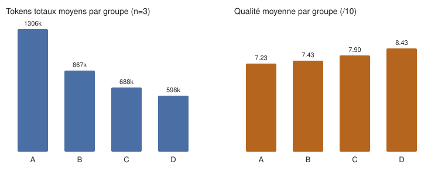

# Benchmark CodeTour × TokenEconomizer — 12 créations, 3 cycles

Exécuté le 2026-11-27 · plan gelé (`plan.json`, graine 20261127) · 12/12 créations réussies · 12/12 évaluations à l'aveugle

## 0. Faisabilité, protocole et limites

Le protocole a été exécuté tel que demandé. Neuf points conditionnent sa lecture :

1. **Métriques accessibles.** Chaque run est une session `pi -p` neuve ; ses jetons et son coût sont lus dans le journal de session du fournisseur (`usage` par message assistant). Pi distingue `input` (hors cache), `cacheRead`, `cacheWrite` et `output` ; `total = input + output + cacheRead + cacheWrite` (vérifié : la somme égale `totalTokens`, donc aucun double comptage du cache ni du reasoning). Le coût est celui que Pi calcule à partir de son catalogue de modèles (coût **estimé**, pas facturé).
2. **Isolation.** Chaque run tourne dans un worktree Git détaché dédié (`run-01`…`run-12`, commit identique, aucun `.tours`), l'état TE est restauré depuis un instantané unique avant chaque run, la configuration du groupe est appliquée puis **vérifiée** (`te config show` + un vrai appel au hook `SessionStart` dont la sortie injectée est archivée). Les identifiants de groupe n'apparaissent ni dans le chemin du workspace ni dans le prompt vu par l'agent.
3. **Knowledge initial.** La base Knowledge de TE était **vide** au départ : `knowledge=on` n'aurait rien injecté. Elle a donc été constituée avant le benchmark, par une session d'exploration en lecture seule (7 fichiers, 6 cartes proposées), puis figée : le même instantané est restauré avant chaque run et la même carte est rendue injectable dans chaque workspace. Ce Knowledge est donc identique pour les 12 runs.
4. **Knowledge est indexé par chemin de workspace** dans TE (`sha256(realpath)`). Le harnais recopie donc l'état Knowledge initial sous la clé de chaque worktree, sinon le groupe C n'aurait rien reçu. Sans cette recopie, `knowledge=on` est silencieusement inopérant hors du répertoire d'origine.
5. **Non mesuré (exclu, comme demandé).** L'orchestration du benchmark, la configuration, les 12 évaluations. Sont aussi exclues les **propres requêtes modèle de TE** (proposeur de micro-skills/Knowledge et juge du loop guard) : elles tournent après la session, dans un processus détaché qui ne persiste pas de session Pi. Leur coût n'est donc pas accessible et n'est **pas** inclus dans les coûts ci-dessous (il sous-estime B, C et D).
6. **Prompt de création figé** (`prompts/creation.template.md`) : identique pour les 12 runs, seul `fileName` change (`benchmark-<groupe>-<cycle>.tour`). Une session `pi -p`, modèle `mistral/deepseek-v4-1-flash-1017`, thinking `high`, même commit, mêmes instructions système.
7. **`.tours/` vide au départ.** Le harnais remet le workspace à zéro avant chaque run, ce qui a aussi retiré le fichier suivi `.tours/changes.tour` présent au commit. Les 12 runs ont donc démarré avec un `.tours/` absent, et un `git status` montrant sa suppression — condition identique pour les 12, et aucun transcript n'y a réagi (aucune mention de `changes.tour` hors du texte de la compétence).
8. **Évaluation à l'aveugle** : 12 nouvelles sessions, même modèle, même grille, ordre aléatoire indépendant (`eval-plan.json`), tour copié en `.tours/project.tour` dans un workspace au nom neutre (`run-NN`), identifiant, groupe, configuration et métriques non communiqués. Les affirmations techniques ont été vérifiées dans le code (42 à 94 affirmations vérifiées par évaluation). Les sessions d'évaluation ont subi l'injection TE laissée par le dernier run (manuel micro-skills, identique pour les 12 évaluations).

9. **Concurrence pendant l'évaluation (sans effet sur les mesures).** Les 12 créations mesurées se sont déroulées de 14:33:11 à 15:08:22. À 15:15:30, un **second benchmark, lancé par un autre agent dans le même dépôt**, a commencé à modifier le même état TE (la configuration est globale au dépôt) ; il a chevauché 11 des 12 évaluations (15:11:21 → 15:35:54). Les métriques des runs sont donc intactes (aucun chevauchement), mais le manuel micro-skills injecté dans les sessions d'évaluateur a pu changer pendant cette phase : aucune carte Knowledge n'a été injectée dans ces sessions, et la grille, le modèle et l'aveuglement sont restés identiques. Résidu mesuré : ≤ 480 octets de manuel dans des contextes de ~1 M tokens.

## 1. Résultats bruts

| id | cycle | pos. | groupe | statut | tokens entrée | cache lu | tokens sortie | tokens totaux | non cachés | coût ($) | durée (s) | outils | étapes | qualité | anomalie |
|---|---|---|---|---|---|---|---|---|---|---|---|---|---|---|---|
| `benchmark-A-01` | 1 | 4 | A | success | 61 460 | 1 322 112 | 26 882 | 1 410 454 | 88 342 | 0.0600 | 152.1 | 56 | 14 | 7.70 | — |
| `benchmark-A-02` | 2 | 2 | A | success | 44 633 | 972 544 | 21 631 | 1 038 808 | 66 264 | 0.0462 | 205.6 | 49 | 12 | 7.30 | — |
| `benchmark-A-03` | 3 | 1 | A | success | 61 135 | 1 384 064 | 24 876 | 1 470 075 | 86 011 | 0.0579 | 259.0 | 53 | 15 | 6.70 | — |
| `benchmark-B-01` | 1 | 2 | B | success | 51 376 | 1 116 032 | 27 327 | 1 194 735 | 78 703 | 0.0560 | 161.8 | 45 | 13 | 8.00 | — |
| `benchmark-B-02` | 2 | 1 | B | success | 36 555 | 487 936 | 14 031 | 538 522 | 50 586 | 0.0312 | 84.8 | 35 | 13 | 7.00 | — |
| `benchmark-B-03` | 3 | 4 | B | success | 35 669 | 810 240 | 20 430 | 866 339 | 56 099 | 0.0409 | 90.1 | 45 | 13 | 7.30 | évaluation re-parsée (sans réévaluation) |
| `benchmark-C-01` | 1 | 3 | C | success | 43 606 | 705 152 | 20 822 | 769 580 | 64 428 | 0.0430 | 103.6 | 36 | 10 | 7.70 | — |
| `benchmark-C-02` | 2 | 4 | C | success | 35 491 | 777 472 | 15 864 | 828 827 | 51 355 | 0.0351 | 368.2 | 49 | 13 | 7.70 | — |
| `benchmark-C-03` | 3 | 2 | C | success | 33 509 | 420 224 | 11 925 | 465 658 | 45 434 | 0.0273 | 163.1 | 31 | 11 | 8.30 | — |
| `benchmark-D-01` | 1 | 1 | D | success | 36 438 | 444 544 | 12 629 | 493 611 | 49 067 | 0.0292 | 65.2 | 36 | 11 | 8.30 | métriques relues (bug de harnais, sans relance) |
| `benchmark-D-02` | 2 | 3 | D | success | 54 734 | 646 400 | 12 682 | 713 816 | 67 416 | 0.0362 | 171.1 | 31 | 12 | 8.70 | — |
| `benchmark-D-03` | 3 | 3 | D | success | 35 761 | 534 400 | 15 098 | 585 259 | 50 859 | 0.0326 | 212.3 | 41 | 14 | 8.30 | — |

Détail par critère d'évaluation :

| id | exactitude | exhaustivité | absence d'erreurs | note globale |
|---|---|---|---|---|
| `benchmark-A-01` | 9 | 7 | 7 | 7.70 |
| `benchmark-A-02` | 8 | 7 | 7 | 7.30 |
| `benchmark-A-03` | 7 | 7 | 6 | 6.70 |
| `benchmark-B-01` | 8 | 8 | 8 | 8.00 |
| `benchmark-B-02` | 7 | 7 | 7 | 7.00 |
| `benchmark-B-03` | 8 | 7 | 7 | 7.30 |
| `benchmark-C-01` | 8 | 7 | 8 | 7.70 |
| `benchmark-C-02` | 8 | 7 | 8 | 7.70 |
| `benchmark-C-03` | 9 | 7 | 9 | 8.30 |
| `benchmark-D-01` | 9 | 7 | 9 | 8.30 |
| `benchmark-D-02` | 9 | 8 | 9 | 8.70 |
| `benchmark-D-03` | 8 | 9 | 8 | 8.30 |

## 2. Tableau par groupe

| groupe | succès | tokens totaux moy. (min–max) | non cachés moy. | taux de cache | coût moy. ($) | durée moy. (s) | outils moy. | étapes moy. | qualité moy. | écon. tokens vs A | écon. non cachés vs A | écon. coût vs A |
|---|---|---|---|---|---|---|---|---|---|---|---|---|
| A — Baseline (knowledge off, micro-skills off) | 3/3 | 1 306 446 (1 038 808–1 470 075) | 80 206 | 93.9 % | 0.0547 | 205.57 | 52.67 | 13.67 | 7.23 (6.7–7.7) | +0.0 % | +0.0 % | +0.0 % |
| B — Micro-skills (knowledge off, micro-skills on) | 3/3 | 866 532 (538 522–1 194 735) | 61 796 | 92.9 % | 0.0427 | 112.23 | 41.67 | 13.0 | 7.43 (7.0–8.0) | +33.7 % | +23.0 % | +21.9 % |
| C — Knowledge (knowledge on, micro-skills off) | 3/3 | 688 022 (465 658–828 827) | 53 739 | 92.2 % | 0.0351 | 211.63 | 38.67 | 11.33 | 7.90 (7.7–8.3) | +47.3 % | +33.0 % | +35.8 % |
| D — Combiné (knowledge on, micro-skills on) | 3/3 | 597 562 (493 611–713 816) | 55 781 | 90.7 % | 0.0326 | 149.53 | 36.0 | 12.33 | 8.43 (8.3–8.7) | +54.3 % | +30.5 % | +40.4 % |

*Taux de cache* = tokens lus depuis le cache / tokens totaux. *Non cachés* = entrée hors cache + sortie. Le cache est facturé bien moins cher que l'entrée : l'économie en tokens totaux et celle en coût ne se déplacent pas ensemble.

## 3. Comparaisons

| comparaison | Δ tokens totaux | Δ coût | Δ qualité (points) | cycles où Y < X (tokens) | cycles où Y > X (qualité) | cycles où Y < X (qualité) |
|---|---|---|---|---|---|---|
| A vs B | -33.7 % | -21.9 % | +0.20 | 3/3 | 2/3 | 1/3 |
| A vs C | -47.3 % | -35.8 % | +0.67 | 3/3 | 2/3 | 0/3 |
| A vs D | -54.3 % | -40.4 % | +1.20 | 3/3 | 3/3 | 0/3 |
| B vs D | -31.0 % | -23.7 % | +1.00 | 2/3 | 3/3 | 0/3 |
| C vs D | -13.1 % | -7.1 % | +0.53 | 2/3 | 2/3 | 0/3 |

Détail apparié par cycle (tokens totaux) :

| comparaison | cycle 1 | cycle 2 | cycle 3 |
|---|---|---|---|
| A vs B | c1: A 1 410 454 / B 1 194 735 | c2: A 1 038 808 / B 538 522 | c3: A 1 470 075 / B 866 339 |
| A vs C | c1: A 1 410 454 / C 769 580 | c2: A 1 038 808 / C 828 827 | c3: A 1 470 075 / C 465 658 |
| A vs D | c1: A 1 410 454 / D 493 611 | c2: A 1 038 808 / D 713 816 | c3: A 1 470 075 / D 585 259 |
| B vs D | c1: B 1 194 735 / D 493 611 | c2: B 538 522 / D 713 816 | c3: B 866 339 / D 585 259 |
| C vs D | c1: C 769 580 / D 493 611 | c2: C 828 827 / D 713 816 | c3: C 465 658 / D 585 259 |

La comparaison appariée par cycle est la seule lecture qui neutralise la variabilité entre runs : chaque cycle contient exactement un run de chaque groupe, dans un ordre aléatoire.

## 4. Graphique



```
A  tokens  1 306 446  ██████████████████████████████████████████████
   qualité 7.23/10      ▓▓▓▓▓▓▓▓▓▓▓▓▓▓▓▓▓▓▓▓▓▓▓▓▓▓▓▓▓▓▓▓▓
B  tokens    866 532  ██████████████████████████████
   qualité 7.43/10      ▓▓▓▓▓▓▓▓▓▓▓▓▓▓▓▓▓▓▓▓▓▓▓▓▓▓▓▓▓▓▓▓▓▓
C  tokens    688 022  ████████████████████████
   qualité 7.90/10      ▓▓▓▓▓▓▓▓▓▓▓▓▓▓▓▓▓▓▓▓▓▓▓▓▓▓▓▓▓▓▓▓▓▓▓▓
D  tokens    597 562  █████████████████████
   qualité 8.43/10      ▓▓▓▓▓▓▓▓▓▓▓▓▓▓▓▓▓▓▓▓▓▓▓▓▓▓▓▓▓▓▓▓▓▓▓▓▓▓
```

## 5. Conclusion

- **Meilleur compromis mesuré** : groupe **D** — 597 562 tokens (soit 54.3 % de moins que A), 0.0326 $ (40.4 % de moins que A), qualité 8.43/10 (+1.20 point vs A).
- **Tendance robuste (3/3 cycles appariés)** : B, C et D consomment moins de tokens que A (-33.7 %, -47.3 %, -54.3 %) ; la qualité de D dépasse celle de A dans 3/3 cycles (+1.20 point).
- **Simples tendances (2/3 cycles)** : D consomme moins que B et que C, et B note mieux que A ; à n=3, ces écarts ne sont pas établis.
- **Dispersion** : les notes vont de 6.7 à 8.7 sur les 12 runs, pour un écart entre moyennes de groupe de 1.20 point : la qualité reste un signal faible à cette taille d'échantillon.
- **Recommandation fondée sur ces mesures** : `knowledge=on` (C ou D) pour une création de Project Tour ; les micro-skills seuls (B) réduisent aussi les tokens et le coût, sans effet qualité démontré. Aucune conclusion ferme sur la qualité ni sur les configurations D vs C.

## Annexes

### Coût de la mesure (hors résultats)

Les 12 créations mesurées coûtent 0.4955 $ au total. L'évaluation à l'aveugle, exclue de la mesure, a coûté 0.4027 $ et 10 501 114 tokens sur 12 sessions indépendantes.

### Anomalies et incidents

- **benchmark-D-01** — Métriques manquantes à la première passe : le harnais a construit un chemin de répertoire de sessions erroné (`---private-…` au lieu de `--private-…`). Aucune relance : la session du run était intacte et les métriques ont été relues depuis son fichier `.jsonl`.
- **slot-03 (benchmark-B-03)** — La réponse JSON de l'évaluateur n'a pas été extraite par la première expression régulière (accolades dans une chaîne citée). Aucune réévaluation : la réponse complète a été relue depuis la transcription de la session d'évaluation et re-parsée.
- **Évaluations 02–12** — Un second benchmark concurrent (autre agent, même dépôt, même état TE) a démarré à 15:15:30 et modifié la configuration TE pendant 11 évaluations. Les 12 créations mesurées étaient terminées à 15:08:22 : aucune métrique de run n'est affectée. Aucune réévaluation n'a été faite.
- **Tous les runs** — Workspace initial : `.tours/` absent (le fichier suivi `.tours/changes.tour` a été retiré avec le répertoire) — condition uniforme, sans effet observé ; aucun code source modifié.
- **Valeurs atypiques (conservées)** — `benchmark-C-02` dure 368 s et `benchmark-D-01` 65 s pour la même tâche (rapport 5,6×) ; `benchmark-B-02` ne consomme que 538 522 tokens contre 1 194 735 pour `benchmark-B-01`. Ces points sont atypiques mais valides : aucun n'a été écarté ni remplacé.
- **Tous les runs** — Aucun échec, aucun timeout, aucun code de sortie non nul. Aucun fichier source n'a été modifié : après les 12 runs, le seul écart des worktrees à `HEAD` était la suppression de `.tours/changes.tour` décrite ci-dessus.

### Versions et environnement

| élément | valeur |
|---|---|
| git_commit | `c248a4abdb4a234b635b5249ebe9c3ed9213bc8a` |
| git_branch | `spec-341-integration` |
| git_dirty_worktree | `True` |
| codetour_package_version | `0.1.2` |
| codetour_cli_path | `/Users/dhuyet/.nvm/versions/node/v24.18.0/bin/codetour` |
| tokeneconomizer_commit | `6c89c546efc31ddf13214f18ac941087f7c729bd` |
| tokeneconomizer_version | `0.1.0` |
| pi_version | `1.6.1` |
| node_version | `v24.18.0` |
| model | `mistral/deepseek-v4-1-flash-1017:high` |
| thinking | `high` |
| agent | `pi -p (new session per run)` |
| code_under_study | `git worktree of the recorded commit (detached HEAD)` |

Le worktree analysé est le commit `git_commit`, détaché. La CLI `codetour` installée provient du répertoire de travail (build `dist/`), qui contient des modifications non commitées : le code lu et la CLI exécutée peuvent différer marginalement, de façon identique pour les 12 runs.

### Configuration TE après le benchmark

La configuration a été remise à sa valeur initiale — `knowledge=off`, `microskills=off`, `knowledge_injection=both`, `loopguard=nudge`, `toolprune=auto` — et vérifiée par `te config show`. La base Knowledge créée pour l'expérience a été retirée de l'état vivant (elle reste dans `state/te-state` pour la reproduction) ; un benchmark concurrent peut en recréer. **Réserve** : cette configuration est globale au dépôt et un benchmark concurrent, toujours actif au moment de la rédaction, partage le même état TE ; il peut la modifier après ce rapport.

### Livrables

- `plan.json` — planning gelé (3 cycles × 4 groupes, ordre aléatoire, graine) ; `eval-plan.json` — ordre d'évaluation
- `prompts/creation.template.md`, `prompts/eval-prompt.md` — prompts figés
- `configs/<id>.json` — configuration effective + injection réelle par hook pour chaque run
- `runs/<id>.json` — métriques brutes par run ; `tours/<id>.tour` — les 12 CodeTours
- `metrics/runs.csv`, `metrics/aggregate.csv`, `metrics/comparisons.csv` ; `report-chart.svg`
- `eval/slot-XX.json` — évaluations à l'aveugle (scores, vérifications, réponse complète)
- `state/` — instantané de l'état TE initial et Knowledge de référence restaurés avant chaque run
- `logs/` — sorties complètes des 12 runs
- `report.md` — ce rapport
