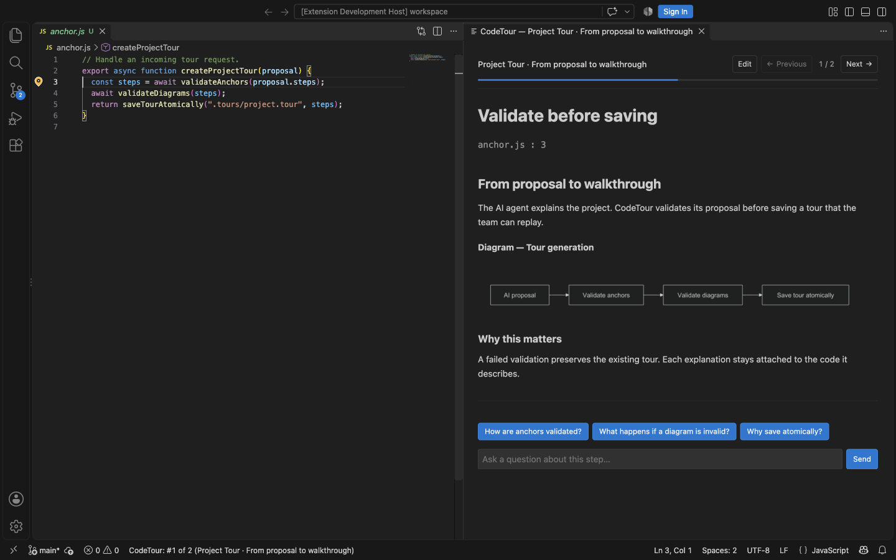

# CodeTour IA

**Explore a codebase, understand a branch, and ask questions right beside the code.**

CodeTour IA is a VS Code desktop extension for guided code walkthroughs. Create
tours with an AI agent or record them yourself, then follow explanations anchored
to the files they describe. Keep tours in your repository so the next developer
can start with the context you already captured.

Built on [Microsoft CodeTour](https://github.com/microsoft/codetour), this fork
adds AI-generated tours, reproducible Git comparisons, Mermaid diagrams, and
conversations about individual steps. Existing `.tour` files remain supported;
see the [migration guide](MIGRATION.md) when switching from the original extension.



*Expanded Description View in a real VS Code session, using a small English demo
tour. [View the light theme](images/screenshots/expanded-description-light.png).*

## What’s new in this fork

| Feature | What you can do |
| --- | --- |
| **Project Tours** | Get an introduction to a project’s purpose, structure, entry points, and execution flows. |
| **Changes Tours** | Follow the intent and impact of a branch’s committed changes, with file steps opening the comparison between the analyzed commits. |
| **Expanded Description View** | Read longer explanations beside the code, with a marker showing the active anchor. Close the panel to return to inline playback at the same step. |
| **Mermaid diagrams** | Read architecture and flow diagrams inside tour descriptions, rendered locally. |
| **Tour Step Conversations** | Ask follow-up questions grounded in the step’s explanation and displayed code, including Git snapshots and unsaved buffers. |
| **Suggested questions** | Start a conversation from question buttons supplied with a generated step. |
| **Native Markdown editing** | Edit an existing step in a VS Code Markdown document, then save it back to the tour with **Save Step**. |
| **Bundled MCP server** | Let an AI agent create validated tours through two dedicated tools, with automatic discovery in VS Code and commands to configure Codex. |

The original recording and playback workflow remains available: file, directory,
selection, and content steps; Markdown explanations; Git references; linked tours;
and tour exports with embedded source.

## Install

Requires **VS Code 1.101 or later** on desktop.

1. Download the `.vsix` matching your platform from [GitHub Releases](https://github.com/maurice30120/codetour/releases).
2. In VS Code, run **Extensions: Install from VSIX...** and select the file.
3. Open a project folder and find **CodeTour** in the Explorer.

For installation from the terminal, replace the filename with the downloaded asset:

```bash
code --install-extension ./codetour-<platform>-<version>.vsix
```

Upgrading from Microsoft CodeTour? Follow [MIGRATION.md](MIGRATION.md).

## Generate your first tour

The extension bundles a local MCP server exposing `create_project_tour` and
`create_changes_tour`. VS Code and GitHub Copilot discover a server for each
workspace folder automatically. For Codex, run **CodeTour IA: Configure MCP for
Codex** from the Command Palette. After moving or updating the extension, use
**CodeTour IA: Repair MCP Configuration for Codex** if its configuration is stale.

Ask your connected AI agent:

**To understand a project**

```text
Analyze this repository and use create_project_tour to create a Project Tour
in English. Explain its purpose, entry points, main components, and execution
flows. Start with an orientation step and add diagrams where they help.
Include suggested questions for the most important steps.
```

**To understand a branch**

```text
Analyze this branch’s committed changes since main and use create_changes_tour
to create a Changes Tour in English. Resolve the current HEAD to its full SHA.
Explain the intent, implementation, impact, and relevant tests. Exclude
uncommitted changes.
```

Replace `main` with your base branch. Project Tours are saved to
`.tours/project.tour`; Changes Tours to `.tours/changes.tour`. Generating the same
type again replaces its reserved file after validation. Both tools also accept
`workspacePath` to target a project inside a larger workspace.

The **agent** analyzes the code and writes the explanation. The **local MCP
server** validates and saves the tour; it does not call a model or access the
network. Your chosen AI provider may use network services.

See the [MCP guide](packages/mcp-server/README.md) for other clients, arguments,
validation rules, and Git reference policies.

## Read, ask, and edit

1. Start a tour from the **CodeTour** Explorer view or **CodeTour IA: Start Tour**.
2. Follow the inline explanations using **Next** and **Previous**.
3. Run **CodeTour IA: Show Expanded Description** to read beside the code and
   access the step conversation. Ask a question or select a suggested question
   when one is available.
4. To revise an editable step, choose **Edit**, update the Markdown draft, then
   run **CodeTour IA: Save Step**. The document’s normal Save action does not
   save the tour. Modified drafts offer Save, Discard, or Cancel when leaving.

Each step has its own conversation. Exchanges survive navigation while the
expanded panel remains open; closing it clears the conversations.

### Follow a tour inline

Use the step controls or keyboard shortcuts to move through a tour while the
CodeTour tree and status bar track your progress.


### Connect a conversation agent

Install and authenticate a supported ACP agent separately, and ensure its
executable is available on VS Code’s `PATH`. CodeTour tries installed providers
in this order and keeps the first working one for the reading session:

| Provider | Executable | Selected mode |
| --- | --- | --- |
| Vibe | `vibe-acp` | Ask |
| GitHub Copilot CLI | `copilot --acp --stdio` | Default mode, with tools restricted to `view`, `grep`, and `glob` |
| Codex ACP | `codex-acp` | read-only |
| Claude Agent ACP | `claude-agent-acp` | plan |

CodeTour installs no agent automatically. Conversations are designed for reading
and explanation: the client refuses file writes and terminal requests and checks
tool permissions. Provider modes are not an operating-system sandbox.

If an agent fails before producing answer text, CodeTour tries the next provider.
Once an answer has started, it reports an error without mixing in another agent’s
response. You can stop an answer in progress.

## Record and share your own tours

Run **CodeTour IA: Record Tour**, open a file, and add explanations at the lines
or selections you want to describe. Stop recording when finished, then commit
the `.tour` file alongside your code. You can also export a tour with its source
embedded so someone else can replay it without cloning the repository.

### Record explanations at the code

Add steps directly from the editor and organize them in the CodeTour tree.


### Highlight a selection

Select a span of code before adding a step to focus the explanation on the
relevant lines.


### Export a self-contained tour

Export a tour with its source embedded so another developer can follow it
without a local checkout.


*These four demonstrations come from the original CodeTour and illustrate
workflows retained in CodeTour IA. They show an older VS Code interface;
current Command Palette commands use the CodeTour IA name.*

See the [user guide](docs/user-guide.md) for recording, navigation, Markdown,
sharing, keyboard shortcuts, settings, and the extension API.

## Development

Use **Node.js 24.18.0** and **npm 12.0.1**, pinned in the repository.

```bash
npm ci
npm ci --prefix packages/description-renderer
npm ci --prefix packages/mcp-server
npm test
npm run package
```

Commit all three `package-lock.json` files when changing dependencies.
For real VS Code playback checks and screenshots, follow the
[desktop smoke-test guide](test/vscode/README.md).

- [CI and platform builds](docs/ci.md)
- [Description renderer](packages/description-renderer/README.md)
- [Changelog](CHANGELOG.md)
- [Migration guide](MIGRATION.md)

## Credits and license

CodeTour IA builds on the original CodeTour by Microsoft and its contributors.
The detailed user guide retains documentation and demonstrations from that project.
Licensed under the [MIT License](LICENSE.txt).
