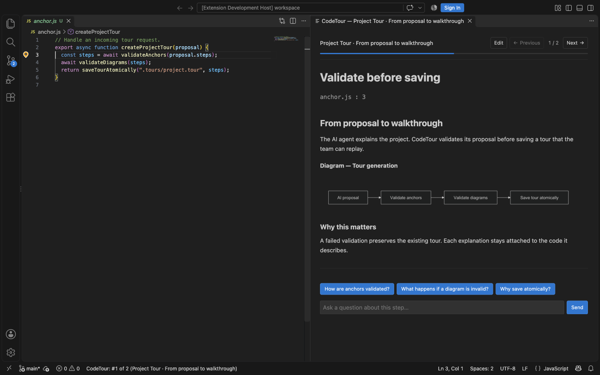

> **Memory interruption:** CodeTour no longer exposes or uses Knowledge or consolidation. A replacement in TokenEconomizer is planned but is not yet available; existing CodeTour knowledge is not migrated. Tour generation remains available.

# CodeTour IA

**Explore a codebase, understand a branch, and ask questions right beside the code.**

**Install or update with one command.** The script detects your platform,
downloads the VSIX that the Release workflow built and attached to the
[latest GitHub release](https://github.com/maurice30120/codetour/releases), and
installs it in VS Code; rerun it after each new release.

macOS, Linux, or Git Bash:

```bash
curl -fsSL https://raw.githubusercontent.com/maurice30120/codetour/main/scripts/install-latest.sh | sh
```

Windows PowerShell:

```powershell
irm https://raw.githubusercontent.com/maurice30120/codetour/main/scripts/install-latest.ps1 | iex
```

The `main` URL tracks the latest stable release. From the `beta` branch, the
same command with `CODETOUR_CHANNEL=beta` (PowerShell: `$env:CODETOUR_CHANNEL`)
also accepts pre-releases; `CODETOUR_TAG=<tag>` pins an exact release.

CodeTour IA is a VS Code desktop extension for guided code walkthroughs. Create
tours with an AI agent or record them yourself, then follow explanations anchored
to the files they describe. Keep tours in your repository so the next developer
can start with the context you already captured.

Built on [Microsoft CodeTour](https://github.com/microsoft/codetour), this fork
adds AI-generated tours, reproducible Git comparisons, Mermaid diagrams, and
conversations about individual steps. Existing `.tour` files remain supported;
see the [migration guide](MIGRATION.md) when switching from the original extension.



*Expanded Description View in a real VS Code session, using a small English demo
tour. [View the light theme](images/screenshots/expanded-description-light.png).*

## What’s new in this fork

| Feature | What you can do |
| --- | --- |
| **Project Tours** | Get an introduction to a project’s purpose, structure, entry points, and execution flows. |
| **Changes Tours** | Follow the intent and impact of a branch’s committed changes, with file steps opening the comparison between the analyzed commits. |
| **Expanded Description View** | Read longer explanations beside the code, with a marker showing the active anchor. Close the panel to return to inline playback at the same step. |
| **Mermaid diagrams** | Read architecture and flow diagrams inside tour descriptions, rendered locally. |
| **Tour Step Conversations** | Ask follow-up questions grounded in the step’s explanation and displayed code, including Git snapshots and unsaved buffers. |
| **Suggested questions** | Start a conversation from question buttons supplied with a generated step. |
| **Native Markdown editing** | Edit an existing step in a VS Code Markdown document, then save it back to the tour with **Save Step**. |
| **Agent-generated tours** | Let an AI agent create validated tours through the CodeTour generation skill and the local `codetour create-project-tour` / `create-changes-tour` commands. |

The original recording and playback workflow remains available: file, directory,
selection, and content steps; Markdown explanations; Git references; linked tours;
and tour exports with embedded source.

## Install

Requires **VS Code 1.101 or later** on desktop.
CodeTour IA is not yet published on the VS Code Marketplace; install it from a
GitHub release.

1. Download the `.vsix` matching your platform from [GitHub Releases](https://github.com/maurice30120/codetour/releases).
2. In VS Code, run **Extensions: Install from VSIX...** and select the file.
3. Open a project folder and find **CodeTour** in the Explorer.

The one-command scripts at the top of this README wrap the platform detection,
the download below, and this terminal installation:

```bash
code --install-extension ./codetour-<platform>-<version>.vsix
```

Upgrading from Microsoft CodeTour? Follow [MIGRATION.md](MIGRATION.md).

## Generate your first tour

Generating Tours needs an AI agent that can run the CodeTour generation skill
and the local `codetour` command, such as the GitHub Copilot CLI or the Pi
coding agent. Installing the extension alone does not generate tours; recording
and replaying Tours never needs an agent. Install the integration with
`codetour --install` (see [Select the agents to install](#select-the-agents-to-install)).

Ask your agent:

**To understand a project**

```text
Analyze this repository and create a Project Tour in English with the CodeTour
skill. Explain its purpose, entry points, main components, and execution flows.
Start with an orientation step and add diagrams where they help. Include
suggested questions for the most important steps.
```

**To understand a branch**

```text
Analyze this branch’s committed changes since main and create a Changes Tour in
English with the CodeTour skill. Resolve the current HEAD to its full SHA.
Explain the intent, implementation, impact, and relevant tests. Exclude
uncommitted changes.
```

Replace `main` with your base branch. Project Tours are saved to
`.tours/project.tour`; Changes Tours to `.tours/changes.tour`. Generating the
same type again replaces its reserved file after validation. `--workspace <dir>`
addresses another project.

The **agent** analyzes the code and writes the explanation. The **local
`codetour` command** validates the proposal and saves the Tour; it does not call
a model or access the network. Your chosen AI provider may use network services.

```sh
codetour create-project-tour --workspace . --proposal proposal.json
codetour create-changes-tour --workspace . --proposal proposal.json
```

The proposal is one JSON document, on standard input when `--proposal` is
omitted. Standard output carries exactly one JSON result: `0` for a created
Tour, `1` for a refused proposal that wrote nothing, `2` for a usage or IO
failure. The [creation rules](packages/tour-generation/README.md) list the
fields, the validation and the Git reference policy; the
[skill](packages/copilot-plugin/skills/codetour-generate/SKILL.md) and its
[path modules](packages/copilot-plugin/skills/codetour-generate/references/)
show the whole generation route.

No MCP server is shipped any more: an MCP client that used the `codetour` server
loses it, and its replacement is this skill plus the CLI. See
[MIGRATION.md](MIGRATION.md) for the break and the migration of an existing
installation.

## Read, ask, and edit

1. Start a tour from the **CodeTour** Explorer view or **CodeTour IA: Start Tour**.
2. Follow the inline explanations using **Next** and **Previous**.
3. Run **CodeTour IA: Show Expanded Description** to read beside the code and
   access the step conversation. Ask a question or select a suggested question
   when one is available.
4. To revise an editable step, choose **Edit**, update the Markdown draft, then
   run **CodeTour IA: Save Step**. The document’s normal Save action does not
   save the tour. Modified drafts offer Save, Discard, or Cancel when leaving.

Each step has its own conversation. Exchanges survive navigation while the
expanded panel remains open; closing it clears the conversations.

### Follow a tour inline

Use the step controls or keyboard shortcuts to move through a tour while the
CodeTour tree and status bar track your progress.


### Connect a conversation agent

Install and authenticate a supported ACP agent separately, and ensure its
executable is available on VS Code’s `PATH`. CodeTour probes the installed Agent
Profiles in this order, preselects the first one that answers, and keeps your
choice for the reading session:

| Agent Profile | Executable | Selected mode |
| --- | --- | --- |
| GitHub Copilot CLI | `copilot --acp --stdio` | Default mode, with tools restricted to `view`, `grep`, and `glob` |
| Vibe | `vibe-acp` | Ask |
| Pi | `pi-acp` | Agent default, behind CodeTour’s read-only launcher (tools `read`, `grep`, `find`, `ls`) |
| Codex ACP | `codex-acp` | read-only |
| Claude Agent ACP | `claude-agent-acp` | plan |

CodeTour installs no agent automatically. Conversations are designed for reading
and explanation: the client refuses file writes and terminal requests and checks
tool permissions. Agent Profile modes are not an operating-system sandbox.

`pi-acp` launches `pi` without any tool restriction and offers no way to pass
one, so CodeTour launches Pi through a small launcher of its own that runs `pi`
with only the reading and searching tools, through the `PI_ACP_PI_COMMAND`
variable the adapter honours. The launcher is written under the system
temporary directory and changes nothing in your Pi configuration; where it
cannot be provided — on Windows, for example — Pi is listed as a connection
error instead of running unrestricted. See
[ADR 0049](docs/adr/0049-restrict-pi-tools-through-a-replacement-launcher.md)
and the [Pi smoke test](docs/pi-agent-smoke.md).

If an agent fails before producing answer text, CodeTour tries the next Agent
Profile, unless you picked one. Once an answer has started, it reports an error
without mixing in another agent’s response. You can stop an answer in progress.

## Try the standalone readers

The standalone CLI is a preview and needs Git, Node.js 24.18.0 and npm 12.0.1.
It reads existing Tours from a Git worktree and creates new ones from a JSON
proposal, with no server and no editor involved. Conversations in these
standalone readers are deferred. The existing VS Code conversation experience
remains available.

From this checkout, install the development dependencies as shown below and
build the CLI:

```bash
npm ci
npm ci --prefix packages/description-renderer
npm run build
CODETOUR_ROOT="$PWD"
```

Then change to a Git worktree that contains an existing Tour (or stay in this
checkout if it contains one). The CLI discovers Tours from the repository root,
even when invoked from a subdirectory. Omit the Tour name for the selection
prompt, or replace `project` below with a Tour title or file name without the
`.tour` extension. Quote titles containing spaces.

```bash
cd /path/to/repository
node "$CODETOUR_ROOT/dist/cli.js" project --renderer html
node "$CODETOUR_ROOT/dist/cli.js" project --renderer terminal
```

The HTML command opens a browser page; use **Next**, **Previous** and **Finish**
to check the steps and their code context. The terminal is the default when
`--renderer` is omitted; it reads the Tour in the calling terminal itself
(never an independent terminal window): use
`n`/`p` or the arrow keys to move between steps, `j`/`k` to scroll, and `q` to
finish. Check that the explanation and relevant source or diff correspond to
the same Tour Step in both interfaces. Keep the invoking terminal open if using
the interactive Tour selection prompt.

The same bundle creates Tours from any workspace (Git or not):

```bash
cd /path/to/workspace
node "$CODETOUR_ROOT/dist/cli.js" create-project-tour --workspace . --proposal proposal.json
node "$CODETOUR_ROOT/dist/cli.js" create-changes-tour --workspace . --proposal proposal.json
```

`--workspace` is required on every creation, so nothing is written outside the
workspace you name. See the
[standalone distribution guide](docs/standalone-distribution.md) for the
packaged launcher, the artifact layout and the acceptance suite.

### Select the agents to install

`codetour --install` lists the agents this delivery generates Tours with — the
GitHub Copilot CLI and the Pi coding agent — with their current state, and
installs the ones you choose:

```text
Select the CodeTour agents to install; the VS Code extension stays available with 'codetour --install vscode'.
  1. GitHub Copilot CLI (installed)
  2. Pi coding agent (absent)
Agent numbers or ids (empty to cancel): 1,2
```

A numbered answer, an agent id, or both are accepted; an empty answer installs
nothing. Without an interactive terminal the command fails with one
instruction instead of installing everything. `codetour --install all` is the
non-interactive batch over **every host this machine actually has**, from one
CLI revision, without a checkout or network:

```text
Agent integrations:
  copilot: installed
  pi: installed
  vscode: skipped (No CodeTour .vsix was found in the current directory or next to the CLI. …)
```

Compatibility means the host is present and can hold the integration. An
absent host is **skipped with its reason**, never a fatal error; an agent that
fails is reported and makes the command exit non-zero without stopping the
others. `--install <agent>` names exactly one agent, and `--uninstall` removes
every integration this CLI installed. `CODETOUR_DISABLE_AGENTS=vscode,pi` keeps
agents out of a batch (CI, a shared account, a machine served by another
build); naming an agent explicitly ignores it.

`codetour --agents` reports one state per agent: `absent` (the host is not
installed), `incompatible` (the host is installed but cannot hold the
integration), `not-installed`, `installed`, `outdated` or `incomplete`, each
with one line saying what is wrong and what to run. Reinstalling an
installation that is already current rewrites nothing, and an uninstall
removes only the files this CLI wrote: a modified or foreign file at a managed
path is reported and left in place, and third-party settings, packages and
skills are preserved.

### Install the Copilot plugin

`codetour --install copilot` installs two surfaces from the same CLI revision,
without a checkout or network:

1. the experimental `/codetour` extension (reader and generation entry point);
2. the **Agent Plugins 1.0** plugin from
   [`packages/copilot-plugin/`](packages/copilot-plugin/README.md), embedded in
   the CLI bundle by `scripts/embed-copilot-plugin.js`.

The plugin carries no server. It ships the `codetour-generate` skill, which
explores the workspace and creates the Tour with the installed `codetour`
command, the critical-review pack a `critical` Changes Tour follows, and an
informative `agentStop` hook. The install also retires what an older release
left behind: the MCP-routed adapter in `<COPILOT_HOME>/extensions/codetour`, the
`codetour` entry of `~/.copilot/mcp-config.json` when its bytes match a launch
shape this CLI wrote, and the guarded run states of the workspace. A same-named
server written by someone else is preserved and reported.

Verify the installed surfaces (the plugin needs GitHub Copilot CLI 1.0.106 or
later; Agent Plugins 1.0 and the `agentStop` contract were verified on 1.0.106):

```sh
copilot plugin list           # codetour
copilot skill list            # codetour-generate, from the plugin
codetour --agents             # integration state and repair command
```

Generate from a trusted Git worktree:

```text
/codetour generate project Explique le flux de paiement
```

`/codetour` collects the choices and delivers them to the skill, which resolves
one workspace, explores it, and hands a JSON proposal to `codetour
create-project-tour --workspace <dir>`. The CLI validates the proposal, writes
the Tour atomically and answers with one JSON document; a refused proposal
writes nothing and reports the fields to fix. When the response settles, the
hook reads the creation journal (`<workspace>/.tours/.log/creations/`) and
reports the Tours that response created with one token reading. It never blocks,
never asks for a continuation and never writes Tour content. See the
[plugin README](packages/copilot-plugin/README.md) for details and the verified
limits of that report.

### Choose an agent in the terminal reader

Press `h` to choose an installed agent, `m` to choose one of its announced
models, and `o` to open the active step in VS Code. Opening the model list
starts a read-only session without sending a question.

### Install the Pi plugin

`codetour --install pi` installs the same integration for the Pi coding agent
from the same CLI revision, without a checkout or network:

1. the **Pi package** from
   [`packages/pi-plugin/`](packages/pi-plugin/README.md), embedded in the CLI
   bundle by `scripts/embed-pi-plugin.js`;
2. its declaration in `<agent-dir>/settings.json` under `packages[]`, with
   `<agent-dir>` = `PI_CODING_AGENT_DIR` or `~/.pi/agent`;
3. a `launcher.json` naming the CLI that performed the install, so a stale
   `codetour` on `PATH` cannot serve the session.

A direct `pi install ./packages/pi-plugin` installs the same package without
that launcher. `/codetour` opens the native **Générer / Lire** menu; the
generation choices are delivered to the `codetour-generate` skill, which
explores the workspace and creates the Tour with the installed CLI
(`codetour create-project-tour --workspace . --proposal -`). No MCP server is
registered and no run state is written. When the response settles, the
extension reads the creation journal and reports the Tours that response
created, with one token reading; the report never blocks and stays silent when
nothing is attributed. The [plugin README](packages/pi-plugin/README.md)
documents the surface and its verified limits (TUI-only report, no response
identity, sub-agent sessions not attributable).

```sh
codetour --install pi         # package + declaration
pi list                       # codetour-pi-plugin, from the managed directory
codetour --agents             # integration state and repair command
```

### Use it from the Copilot CLI

Follow the [Copilot CLI plugin setup](docs/copilot-cli-adapter.md) and start
Copilot from a trusted Git worktree:

```bash
copilot --experimental
```

Generate with the plugin's skill, or ask for a Tour in plain language:

```text
/codetour-generate type=project Explique le flux de paiement
/codetour-generate type=changes reviewMode=critical Revue de ma branche
```

The skill runs the installed `codetour` CLI and the Tour appears under `.tours/`.
When the response settles, the plugin's hook prints the Tours that response
created and one token reading; it never blocks. Read them from your shell:

```bash
codetour "My Tour"
codetour "My Tour" --renderer html
```

CodeTour no longer installs a `/codetour` command, an MCP server or a run state
in the session; the [plugin documentation](docs/copilot-cli-adapter.md) records
what that previous route did and what replaced it.

For automated checks, run `npm test` from the CodeTour checkout. The real VS
Code extension smoke tests are separate; see the desktop smoke-test guide below.
To build and test a reader distribution that includes its own runtime, see the
[standalone distribution guide](docs/standalone-distribution.md). Packaging and
real Copilot integration have separate acceptance checks; a successful
development launch alone does not establish them.

## Record and share your own tours

Run **CodeTour IA: Record Tour**, open a file, and add explanations at the lines
or selections you want to describe. Stop recording when finished, then commit
the `.tour` file alongside your code. You can also export a tour with its source
embedded so someone else can replay it without cloning the repository.

### Record explanations at the code

Add steps directly from the editor and organize them in the CodeTour tree.


### Highlight a selection

Select a span of code before adding a step to focus the explanation on the
relevant lines.


### Export a self-contained tour

Export a tour with its source embedded so another developer can follow it
without a local checkout.


*These four demonstrations come from the original CodeTour and illustrate
workflows retained in CodeTour IA. They show an older VS Code interface;
current Command Palette commands use the CodeTour IA name.*

See the [user guide](docs/user-guide.md) for recording, navigation, Markdown,
sharing, keyboard shortcuts, settings, and the extension API.

## Development

Use **Node.js 24.18.0** and **npm 12.0.1**, pinned in the repository.

```bash
npm ci
npm ci --prefix packages/description-renderer
npm test
npm run package
```

Install the local pre-commit guard once per clone with `git config core.hooksPath .githooks`:
it type-checks and runs the fast Copilot hook tests before every commit (a few
seconds, no full build), and bypasses itself for one commit with
`CODETOUR_SKIP_PRE_COMMIT=1`. It reuses the last `npm run build`, so build once
after a fresh clone.

Commit both `package-lock.json` files when changing dependencies.
For real VS Code playback checks and screenshots, follow the
[desktop smoke-test guide](test/vscode/README.md).

- [CI and platform builds](docs/ci.md)
- [Example Knowledge cards](docs/knowledge-exemple/README.md)
- [Description renderer](packages/description-renderer/README.md)
- [Changelog](CHANGELOG.md)
- [Migration guide](MIGRATION.md)

## Credits and license

CodeTour IA builds on the original CodeTour by Microsoft and its contributors.
The detailed user guide retains documentation and demonstrations from that project.
Licensed under the [MIT License](LICENSE.txt).
