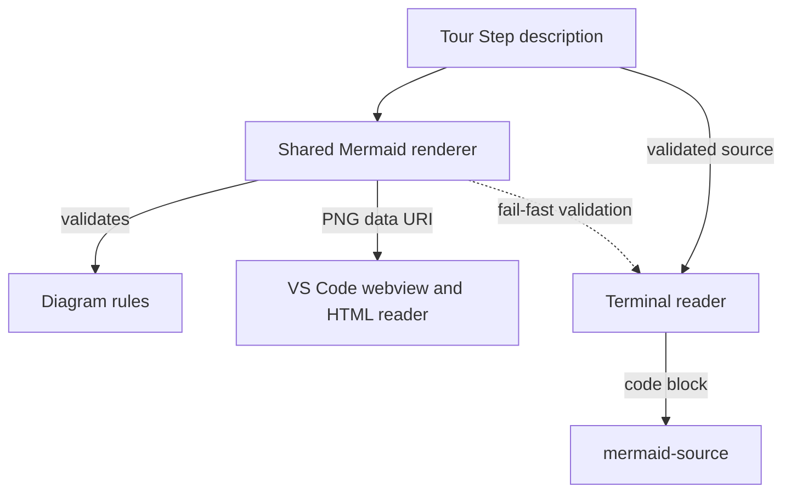

# Show Mermaid source in the terminal reader

A rasterized Mermaid diagram is legible on a pixel surface but not on a
terminal one. The standalone terminal reader renders HTML through TermDOM,
which paints an `` by decoding it to terminal cells: one image pixel per
column, two per row, using half blocks with a foreground and a background
color. A diagram rendered at up to 900 pixels wide is therefore box-filtered
down to the terminal width, and every label collapses into an averaged block of
color while the boxes and arrows survive. The reader sees the shape of a
diagram whose text — the only reason the diagram exists — is gone.

The terminal surface therefore never shows a raster. When a terminal-native
renderer is installed, the reader draws the diagram in box-drawing characters:
`termaid` (MIT, a `brew install termaid` or `pip install termaid` away) is run
as a subprocess with the validated Mermaid source on stdin and the terminal
width as its fitting target, and its text is shown in a code block marked
`diagram`. The drawing is memoized per source and width, so moving back and
forth between Steps does not re-render it. Without that command — or when it
cannot draw the source, times out, or returns nothing — the reader falls back
to the authoritative Mermaid source in a code block marked `mermaid-source`, so
no Markdown renderer treats it as a diagram. `CODETOUR_TERMAID` names the
executable or, set empty, turns terminal diagrams off. Neither path adds a
dependency the reader must install: `termaid` is discovered on `PATH`, is never
downloaded automatically, and its failure only changes what the Step displays.

The source is still validated at the reached step with the shared renderer, so
an invalid diagram fails that step exactly like every other unsupported
terminal content; only the output changes, never the acceptance rules.
Reading surfaces with real pixels keep the rasterized PNG described in ADR
0007: the VS Code webview and the standalone HTML reader.

The standalone HTML reader renders every step description through the same
`renderDescription` seam before Markdown conversion, so Mermaid fences become
`data:image/svg+xml;base64` images — the sanitized SVG, not its raster — and
local PNG/JPEG tour assets are inlined against the Tour Workspace. The
generated document stays self-contained — one file, no server, no `file:`
origin — and the diagrams stay sharp at every zoom level and on Retina
displays. The dark theme draws transparently, so the SVG composites onto the
reader's dark page without an extra background. Native comments keep the PNG
from ADR 0007 because they cannot display an SVG data URI; the format is an
explicit option of the shared render seam, never a replacement.

This trades a diagram in the terminal for a diagram one keystroke away in a
browser, and accepts a duplicated source of presentation (SVG for pixels,
source for cells) in exchange for never showing a reader an unreadable image.
A terminal-native diagram renderer — box-drawing layout, or a terminal graphics
protocol — remains possible later; this decision only refuses to fake one from
a raster.

