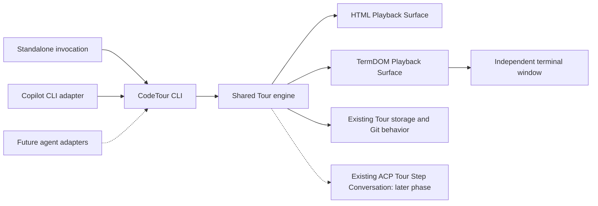

# Spec — Autonomous CodeTour CLI and TermDOM playback (POC)

**Status:** Implementation in progress; standalone ACP conversations deferred to a later phase

**Decision date:** 2026-10-29  
**Primary integration:** GitHub Copilot CLI  
**Long-term objective:** Agent-agnostic CodeTour playback  
**Target branch:** `feature/spec-71-integration`

## Problem Statement

CodeTour IA currently provides guided Project Tours and Changes Tours inside VS Code. A reader using GitHub Copilot CLI in a standalone terminal should be able to explore those same Tours, follow explanations, inspect the code and Git diffs, see Mermaid diagrams without opening VS Code or recreating an IDE. Step-specific questions in the standalone readers are deferred to a later phase.

A reader must not first install and launch a terminal multiplexer. The reading application should be independent of the invoking agent, remain usable after that agent closes, and eventually be reusable from other code agents. Deployment must work on Windows and macOS without administrator privileges.

The existing Tour creation, storage, discovery, editing, Git comparison, ACP security and other CodeTour behaviors are not subjects for reinvention. This delivery exposes the existing reading capabilities through new playback surfaces and establishes their real technical limits; standalone ACP conversations are deferred.

## Solution

Build an **autonomous CodeTour CLI** exposing the shared existing Tour engine and two playback renderers:

- **HTML**: a standalone HTML playback window, keeping the current rich explanation experience and Mermaid presentation; it must not require VS Code.
- **Terminal**: a TUI implemented with **TermDOM** to interpret suitable HTML/CSS content in a terminal. TermDOM is the **only selected terminal UI framework**; no alternative TUI library is in scope.

The CLI works without an agent: Tours, explanations, code context and diffs remain readable. Standalone agent-backed conversations are deferred to a later phase and are not part of the current delivery. An integration adapter allows Copilot CLI to launch the same CLI and request a Tour; no Tour business logic lives in the Copilot adapter. Architect for adapters for other code agents later, but build **only the Copilot CLI adapter in this POC**.

A terminal-renderer launch opens **one separate terminal window automatically**. Do **not** implement split panes, Zellij, or a modification to Copilot CLI's native sidebar in this POC. A split pane may be investigated in a later phase.

**Diagram — Architecture and ownership boundaries**

The diagram shows desired component boundaries, not proof that the existing code is already separable in this way. Refactor the existing VS Code-bound services progressively behind interfaces while preserving all externally observable behavior.

## User Stories

1. As a reader using Copilot CLI, I want to type `/codetour` and select a Tour so that I can begin reading without VS Code.
2. As a reader, I want `/codetour <tour>` to open a specific Tour so that I can skip selection.
3. As a reader, I want to choose HTML or terminal presentation with a flag so that I can compare the new experiences.
4. As a reader, I want a terminal reader to open in a separate window automatically so that I never have to start a multiplexer.
5. As a reader, I want to navigate previous/next Tour Steps with visible progress so that the guided experience is preserved.
6. As a reader reviewing a PR, I want the Changes Tour to use the same historical Git comparison and code context as the existing CodeTour so that the explanation remains reproducible.
7. As a reader, I want file references, line ranges and relevant code excerpts to remain intelligible without a VS Code editor.
8. As a reader, I want Markdown/HTML explanations, links and supported visual content to be displayed in the terminal so that the content of a Tour is not duplicated.
9. As a reader, I want Mermaid diagrams displayed where TermDOM and the chosen presentation path support them so that architecture explanations are usable.
10. **Later phase:** As a reader, I want to ask step-specific questions and use suggested questions through the existing ACP behavior so that I can deepen my understanding.
11. **Later phase:** As a reader, I want ACP questions to remain read-only and grounded in the displayed step so that the agent cannot silently modify my repository.
12. As a reader, I want the CodeTour window to stay open if Copilot exits so that I do not lose my place.
13. As a reader, I want to use CodeTour without a connected agent so that reading does not depend on an AI service.
14. As a reader, I want to launch `codetour` directly from a terminal so that the reader can also be tested and used independently of Copilot.
15. As a reader inside a Git repository, I want CodeTour to discover the repository root from a nested working directory so that paths and Tours resolve correctly.
16. As a reader, I want to see an explicit error if no Git repository is available so that a misleading workspace is not silently selected.
17. As a reader, I want unsupported terminal rendering to stop the Tour with an actionable diagnostic so that a POC incompatibility is not concealed.
18. As a maintainer, I want one shared Tour format and engine for both readers so that there is no divergent creation or comparison logic.
19. As a maintainer, I want deterministic CLI end-to-end tests so that the new reader can be validated without paid AI calls. Fake-ACP end-to-end tests for standalone conversations belong to the later phase.
20. As a maintainer, I want a Copilot integration smoke test so that launching and independence are validated in the real host.
21. As an enterprise user, I want a self-contained Windows/macOS distribution requiring no administrator access or preinstalled Node.js so that locked-down machines can run the reader, subject to endpoint security policies.
22. As a future adapter author, I want a stable CLI entry point so that OpenCode, Claude Code or Codex can launch CodeTour without importing its internal engine.

## Implementation Decisions

### 1. Preserve the existing domain and behavior

- Reuse the current Tour schema, on-disk files, discovery, generation, recording, editing and storage policies **without behavioral changes**. No format migration, new Tour persistence or change to the creation workflow.
- Reuse the current Project Tour and Changes Tour mechanics, Tour Anchors, persisted Git refs/snapshots and diff semantics. Do not replace Git comparison with a new GitHub API workflow, and do not redefine how PR changes are selected.
- Standalone ACP conversations are deferred. When implemented later, reuse the current ACP provider negotiation, security and read-only rules, step context, per-step conversation histories and suggested questions; do not add agent switching or a new agent protocol. Existing VS Code ACP behavior remains unchanged.
- Never write the current playback step into a `.tour` file. For the CLI POC, keep the active step in process memory; closing the CLI does not require session restoration.
- The VS Code extension keeps its existing native playback, Expanded Description View and authoring flows. Extraction into a shared core is an internal refactor covered by regression tests.

### 2. CLI contract and workspace selection

- User-facing interface: `codetour [tour] [--renderer html|terminal]`.
- The Copilot entry point is `/codetour [tour] [--renderer html|terminal]`, subject to validating its extension/command argument contract in the installed CLI.
- **Default renderer: `html`.** `--renderer terminal` explicitly selects TermDOM. No automatic renderer detection in this POC.
- With no Tour argument, show the **existing** discovered Tour list for interactive selection; with an argument, resolve the requested Tour using existing rules. Do not hardcode discovery to a new directory or naming scheme.
- Use the current working directory to identify the enclosing Git worktree root (including invocation from a subdirectory), then use existing CodeTour project/discovery rules. When Git is absent, report a clear error; do not silently use an unrelated directory.
- A standalone CLI launch and a Copilot-initiated launch use the same implementation. A Tour launch starts a normal read session, not a Tour creation process.
- Invalid renderer flags, unknown Tours, missing roots and other startup errors produce a nonzero exit and a helpful message.

### 3. Presentation and code context

- Share the source Tour description and resolved step/code context between HTML and TermDOM; render differently where required but never create a second Tour format.
- Keep previous/next navigation, step title, position/progress, anchors, path and line information, Markdown explanations, Mermaid diagrams and Git diffs as **playback-parity targets**. Agent questions are a later-phase parity target.
- For code review, display relevant code context and the existing Changes Tour diff. **Diff2Html** can provide an HTML presentation of the existing Git diff where this is compatible with the chosen surface; it must not own Git comparison or alter snapshot semantics. Reuse existing code/diff data as the authoritative source.
- This is a **guided reader, not an IDE**. Do not add a symbol index, click-to-definition engine, editor, or arbitrary source navigation. A reader may be able to ask the ACP agent to explain a referenced method in the later phase. No promise of native code-editor navigation inside Copilot CLI.
- The existing Mermaid source and validation constraints remain authoritative. The current VS Code-rendered PNG/SVG strategy is not assumed to work in terminals. Prove that TermDOM can show an intelligible result before claiming Mermaid parity.
- TermDOM is the selected terminal rendering technology. Its real support for the current HTML/CSS, complex layouts, mouse interaction, images, Mermaid and diffs is **a POC hypothesis, not an established capability**.
- Do not invent a second HTML document model or separate stored content for terminal use.

### 4. Windows, macOS and window lifecycle

- `--renderer terminal` launches a **second terminal window** and runs the independent TermDOM reader there. No embedded sidebar and no dynamic split of the already-running Copilot window.
- The second reader is not owned by Copilot's lifecycle. Closing Copilot does not close CodeTour. Closing CodeTour releases its own resources; an eventual standalone ACP session must also be released.
- Do not require the user to launch Zellij, tmux, an IDE, or an extra command manually.
- HTML mode presents a separate standalone HTML window; its window-host technology is an implementation detail to validate, not an excuse to require VS Code.
- Keep dependencies and platform assumptions minimal. Development installs may use Node.js/Bun and normal tooling, but **POC acceptance requires standalone distribution** for Windows and macOS (Intel and Apple Silicon where supported), without Node.js installed and without administrator privileges.
- Operating-system execution controls and enterprise allowlisting can still block unsigned or unapproved binaries; document this limitation and test on representative locked-down environments where possible.

### 5. Agent independence and integration boundary

- Copilot CLI is a **launcher/adapter**, not CodeTour's runtime host. It may pass the requested Tour and renderer to the autonomous CLI.
- In the later ACP phase, the CodeTour ACP connection must remain independent of the invoking Copilot CLI session. Having two separate agent sessions is acceptable and intended.
- Browsing, navigation and diff reading work without an ACP provider. Standalone conversations are deferred, not represented as implemented; when introduced later, provider unavailability must be visibly explained without blocking reading.
- Retain the existing CodeTour communication mechanisms. **Do not add a new local HTTP server, socket protocol or IPC bus** merely to connect the two windows in this POC.
- Prior discussion requested possible agent-driven next/previous commands. Implement them **only if** an existing supported integration seam can provide them without a new transport; otherwise document them as an integration limitation rather than silently violating the no-new-protocol decision.
- Design the CLI boundary so future agent adapters need only a thin launcher. Do not implement OpenCode, Claude Code or Codex adapters now.

### 6. Rendering incompatibility policy (POC only)

- Check each Tour Step when the reader reaches it, **not** by prevalidating all steps at startup.
- If TermDOM cannot correctly render the reached step, **stop the entire Tour** immediately. Do not silently reduce the content to plain text, skip the step, switch to HTML or continue.
- Report the Tour identity, step index/title, affected content type and useful underlying failure details. Return a failure result observable by automated tests.
- This fail-fast policy applies to terminal rendering only; do not change the behavior of the existing VS Code/HTML renderer.
- The POC is intended to discover real TermDOM limitations; fixes in CodeTour or upstream contributions to TermDOM may follow, but automatic fallback is explicitly out of scope.

## Testing Decisions

Favor **observable behavior at public boundaries**, not implementation-specific mocks. Existing VS Code host tests, Mermaid/description-renderer tests, Git snapshot tests and fake-agent ACP transport tests provide the patterns to extend.

1. **Shared-engine regression:** existing Tour creation, editing, persistence, Git refs, reproducible diff generation, step context, ACP security and VS Code playback behavior remain unchanged.
2. **CLI E2E:** from a temporary Git worktree, invoke the actual CLI from both the root and a nested directory; discover multiple Tours, choose one or pass its name, navigate, and verify renderer flag/default behavior. Verify missing repository, missing Tour and invalid argument diagnostics.
3. **Playback parity:** run the same fixture Tour through HTML and TermDOM and compare semantic step content, code paths/ranges, progress and diff snapshot identity (not pixel-perfect appearance).
4. **TermDOM E2E:** drive the real TUI in a compatible pseudo-terminal, including keyboard navigation, scrolling, HTML content, a representative Changes Tour diff, and a Mermaid step. Suggested-question coverage belongs to the later ACP phase. Record any terminal/platform-specific limitations.
5. **Failure contract:** a known unsupported step causes a nonzero failure upon reaching that step; the Tour terminates, diagnostic identifies the step, and no fallback or remaining-step navigation occurs.
6. **Later-phase standalone ACP E2E:** connect a deterministic fake ACP child process; verify step grounding, per-step history isolation, read-only capability refusals, cancellation and useful no-agent behavior. No paid provider is required for automated test suites. Existing VS Code ACP regression tests remain required for this delivery.
7. **Copilot integration smoke:** in a supported Copilot CLI version, verify that `/codetour` forwards the Tour/flag, launches the separate reader window and requires no manual intermediate command. Verify that closing Copilot leaves CodeTour usable. Treat unverified command APIs as a risk until exercised.
8. **Packaging smoke:** ship platform-specific autonomous launch artifacts, run on Windows and macOS without global Node.js or administrator privileges, then repeat core CLI/TUI tests. This packaging test is a **mandatory POC acceptance gate**, not an optional polish task.
9. **Immutability:** opening, navigating, failing and closing a Tour through either new reader does not modify the Tour file or the repository's committed snapshots.

### Definition of Done

- CLI works both standalone and through a validated Copilot entry point.
- HTML and TermDOM both consume existing Tours; required reader features are tested without changing the Tour format or creation/management behavior.
- TermDOM shows representative real Markdown/HTML, diff and Mermaid samples, or the POC explicitly fails with documented blockers: no false claim of parity.
- A separate terminal window is opened automatically; shutdown of Copilot does not end CodeTour.
- Offline/no-agent reading and existing VS Code read-only ACP safeguards are demonstrated. Standalone ACP safeguards are a later-phase requirement.
- Deterministic E2E and non-regression suites pass on supported platforms; standalone packaging without admin rights and preinstalled Node.js is proven.
- Any unavoidable incompatibility is identified, recorded, and considered a **failed acceptance criterion** rather than hidden behind graceful degradation.

## Out of Scope

- Any changes to the Tour format, creation, recording, editing or storage workflows.
- Changing Project Tour/Changes Tour Git semantics, PR selection or reproducibility rules.
- Standalone ACP conversations in this delivery; they are deferred to a later phase. Rewriting ACP, changing agent-provider selection, adding an ACP agent picker, or merging Copilot and reader conversations remain out of scope.
- New HTTP/IPC protocols, background service, remote synchronization or a new server for window control.
- A terminal multiplexer prerequisite (Zellij/tmux), an in-place Copilot UI sidebar, or automatically split terminal panes. These are potential **future** enhancements only.
- Rebuilding an IDE, symbol navigation or code editing in the CLI.
- Automated renderer choice or a fallback renderer on failure.
- Other agent adapters in the POC; only design the reusable boundary.
- Saving user progress or conversations in Tour files.

## Further Notes and Default Decisions

The interview intentionally ended with permission to choose remaining details by default, prioritizing minimal scope. These implementation defaults are **not** new feature requests:

- Use the simplest launch strategy available on each OS for a separate terminal window; if a platform cannot launch one without a prohibited prerequisite, report the limitation rather than silently adding dependencies.
- Prefer a single CLI entry and thin presentation/adaptor interfaces. Reuse tests and existing capabilities before introducing abstractions.
- Prefer no new persistent settings for the POC. The explicit renderer flag overrides the default `html`.
- Keep failures explicit, paths diagnostic, and changes limited to the new reader and necessary non-behavioral extraction.
- Preserve project terminology: **Tour**, **Tour Step**, **Tour Anchor**, **Changes Tour**, **Playback Surface**, and **Tour Step Conversation**.

### Relevant existing architecture decisions

- [ADR 0004](../adr/0004-use-different-git-reference-policies-by-tour-type.md), [ADR 0010](../adr/0010-persist-resolved-changes-tour-comparison.md) and [ADR 0020](../adr/0020-render-changes-tour-diffs-from-persisted-git-snapshots.md) — Git source and diff semantics.
- [ADR 0007](../adr/0007-render-mermaid-diagrams-within-codetour.md) and [ADR 0009](../adr/0009-centralize-markdown-rendering-and-sanitization.md) — Mermaid and description rendering.
- [ADR 0013](../adr/0013-run-tour-step-conversations-over-acp-as-a-read-only-client.md), [ADR 0014](../adr/0014-fallback-between-acp-agents-with-provider-modes.md) and [ADR 0019](../adr/0019-keep-step-conversations-in-panel-scoped-memory.md) — ACP, agent safety and conversation lifecycle.
- [ADR 0018](../adr/0018-keep-native-playback-with-an-optional-expanded-view.md) — the existing VS Code reading experience is preserved.
- [Project vocabulary](../../CONTEXT.md) and [domain glossary](../../GLOSSARY.md) — canonical language.
